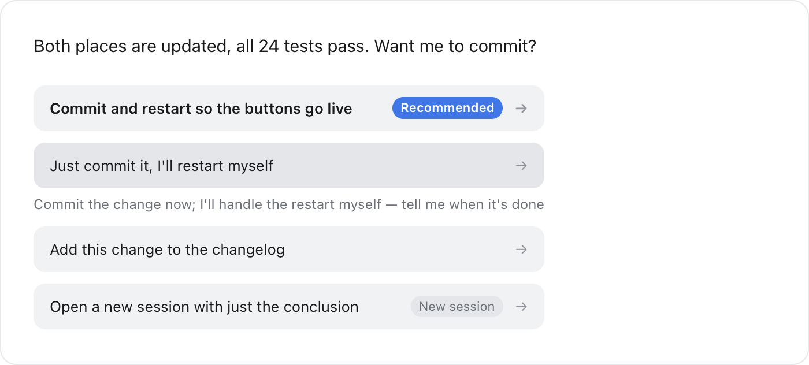

# dsh-suggest-actions


Attaches the model's recommended next steps to the end of every reply in DeepSeek Harness. A click sends that sentence as your message; alternatively, fill it into the composer and edit before sending.



## Features

- **Up to 5 suggestions per turn**, all rendered at once — no expanding, no shortcuts.
- **Click a suggestion to send it**: equivalent to typing the sentence and pressing Enter.
- **The button on the right fills without sending**: it places the sentence in the composer (clearing the previous draft) and returns the caret; you edit and send.
- **Hover to unfold the full text** (focus with the keyboard): the button shows a summary; the complete content unfolds in place.
- **Recommended on top**: the entry the model would do first is moved to the first slot and badged; a "stop" suggestion always sits last.
- **Angles are de-duplicated**: each suggestion carries one stance (cautious, standard, bold, alternative, stop); repeated stances in a turn are dropped.
- **"New session" suggestions**: one click creates a session in the same working directory and puts the text into its composer without sending.
- **No extra model call**: the suggestions are produced by the main model as it closes the turn.

## Why it matters

It removes the step of composing the sentence yourself. After reading a reply you usually already know whether A or B comes next — click the matching suggestion instead. The model proposes concrete actions from context (for example, "restart DSH so the buttons take effect"); if the wording needs adjusting, use the right-hand button to put it in the composer.

Compared with composer-completion plugins: those place a single ghost text inside the composer, require an extra model call to guess it, and still need Tab plus Enter. This plugin offers complete, context-aware actions below the reply, outside the composer, without an additional model call.

## Install

```bash
dsh plugin --profile desktop add dsh-suggest-actions
```

Then **restart DSH and reload the page**: the host reads its plugin list only at startup, and the client bundle must be re-fetched. Both steps are required.

## How it works

- **Host side** registers a non-blocking `suggest_actions` tool: the model calls it once as it closes a turn, passing 2–5 suggestions, and the turn ends normally.
- **Client side** renders in two places: a silent collector on `tool.call.toolview` records the suggestions without rendering; a renderer on `conversation.chat.turnTail` reads them and draws the buttons.
- **Why the turn tail**: DSH folds thinking and tool calls into a single collapsed line, so anything drawn inside a tool card is hidden by default. The turn tail sits outside that folding, so the buttons remain visible when the process is collapsed.
- **Clicking** goes through `conversation.input.shell(sessionId).actions` (set draft, then submit) — the same path as typing the sentence and pressing Enter.
- **Stances are a format constraint**: every suggestion must carry one, and repeated stances are dropped. "Please offer different angles" in a prompt can be ignored; a required field cannot.
- **Buttons share one width**, sized by the longest label, so the arrows align in a column and a long instruction does not stretch its button.

## Configuration and limits

**Per-turn cap**: 5 by default. Set it in the plugin's own bundle patch. Do not put it in the profile's `cordis.patch.yml` — that patch is applied before the plugin's insert line exists, so the row is silently ignored. Restart DSH afterwards.

```yaml
- insert:
    - id: suggest-actions
      name: 'dsh-suggest-actions'
      config:
        maxActions: 2     # 1-6; extra entries are dropped
```

**Limits**: requires DSH 0.1.7 and later; labels are generated by the model and look heavy beyond ~20 characters; a click sends immediately with no confirmation, so use the fill button when editing is needed; clicks are debounced for ~0.9s.

**Interface words and compatibility**: "Recommended", "N more" and "Show less" follow the interface language; suggestions without a stance still render (backwards compatible). Historical turns occasionally show one extra copy of the latest suggestions — a deliberate trade-off: better a rare duplicate than a latest turn without buttons.

## Development

`pnpm test` runs 24 unit tests with no external dependencies. `lib/normalize.js` holds the cleaning rules (whitespace, duplicates, stances, ordering, cap); `lib/index.js` registers the tool and reads config; `lib/client.js` only records the list and renders the UI.

## License

MIT
