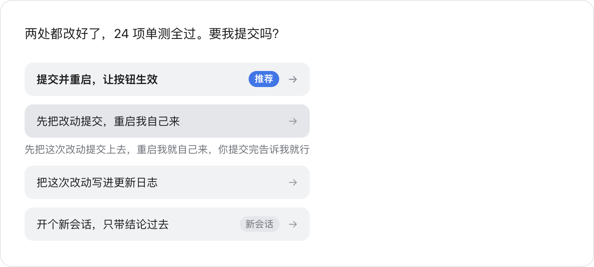

# dsh-suggest-actions（建议按钮）


为 DeepSeek Harness 的每条回复末尾附上模型推荐的下一步动作：点一下，这句话就作为你的消息发出；也可以只把它填进输入框，改完再发。



## 功能特性

- **每轮最多 5 条建议**，全部直接铺开，无需展开或快捷键。
- **点击建议即发送**：与手动输入同一句话后按回车等价。
- **右侧按钮只填入、不发送**：将这句话填入输入框（先清空原草稿）并把光标移回，由你改完自行发送。
- **悬停展开全文**（键盘操作为聚焦）：按钮显示摘要，停留时展开真正会发出的完整内容。
- **推荐项置顶**：模型认为最该先做的一条自动排到首位并标注「推荐」；「可以不做」的一条固定排在最后。
- **角度去重**：每条建议对应一种立场（先验证、常规推进、更用力、换一条路、可以不做），同一轮内重复立场会被丢弃。
- **「开新会话」建议**：一键新建会话（沿用当前工作目录）并把文字放入新会话的输入框，不自动发送。
- **不额外调用模型**：建议由本轮主模型在收尾时给出，不额外发起请求。

## 使用价值

省去自己组织语言这一步。读完一条回复，继续执行 A 还是 B 往往已有判断，直接点对应的建议即可；模型会依据上下文给出具体动作（例如"重启 DSH 使按钮生效"），需要调整措辞时用右侧按钮填入输入框修改。

与输入框补全类插件的差异：后者在输入框内给一条 ghost text，需额外执行一次模型调用进行猜测，按 Tab 采纳后仍需手动回车；本插件给出的是按上下文推荐的完整动作，位置在回复下方、不占用输入框，且不增加模型调用。

## 安装

```bash
dsh plugin --profile desktop add dsh-suggest-actions
```

安装后需**重启 DSH 并刷新一次页面**：host 只在启动时读取插件清单，客户端代码也需重新加载，两者缺一不可。

## 实现原理

- **Host 侧**注册 `suggest_actions` 工具，不阻塞、立即返回：模型在收尾时调用一次并传入 2–5 条建议，本轮正常结束。
- **客户端侧**分两处渲染：`tool.call.toolview` 上的静默采集器记录建议但不渲染；`conversation.chat.turnTail`（轮次尾部）上的展示器读取记录并绘制按钮。
- **渲染位置选在轮次尾部**：DSH 的过程折叠会把思考与工具调用合并为一行，绘制在工具卡片内的内容默认不可见；轮次尾部位于折叠范围之外，因此过程收起后按钮仍然可见。
- **点击行为**经由 `conversation.input.shell(sessionId).actions` 写入会话输入框并提交，与手动输入回车走的是同一条路径。
- **立场为格式约束**：每条建议必须携带一个立场，重复立场在同一轮内被丢弃。提示词中的"请给出不同角度"可能被忽略，必填字段则无法绕过。
- **按钮等宽**：宽度按最长标签计算，箭头因此对齐成列，长指令不会撑开单个按钮。

## 配置与限制

**单轮条数**：默认 5 条，可在插件自身的 bundle patch 中修改。不要写入 profile 的 `cordis.patch.yml`——该 patch 先于插件的插入行应用，此时同 id 的行尚不存在，会被静默忽略。修改后重启 DSH。

```yaml
- insert:
    - id: suggest-actions
      name: 'dsh-suggest-actions'
      config:
        maxActions: 2     # 1–6，超出的丢弃
```

**已知限制**：需 DSH 0.1.7 及其后续版本；按钮文案由模型生成，过长会显得笨重（建议每条不超过 20 字）；点击即发送、无二次确认，需要修改时请用右侧填入按钮；单次点击有约 0.9 秒防连点。

**界面文案与兼容性**：「推荐」「还有 N 条」「收起」跟随界面语言；未携带立场的建议仍会正常显示（向后兼容）。历史轮次偶尔会多显示一份最新建议，这是有意的取舍：宁可偶发重复，也不让最新一轮缺少按钮。

## 开发

`pnpm test` 运行 24 个单测，无外部依赖。`lib/normalize.js` 负责清洗规则（空白、去重、立场、排序、上限），`lib/index.js` 负责注册工具与读取配置，`lib/client.js` 只负责记录名单与绘制界面。

## 许可

MIT
